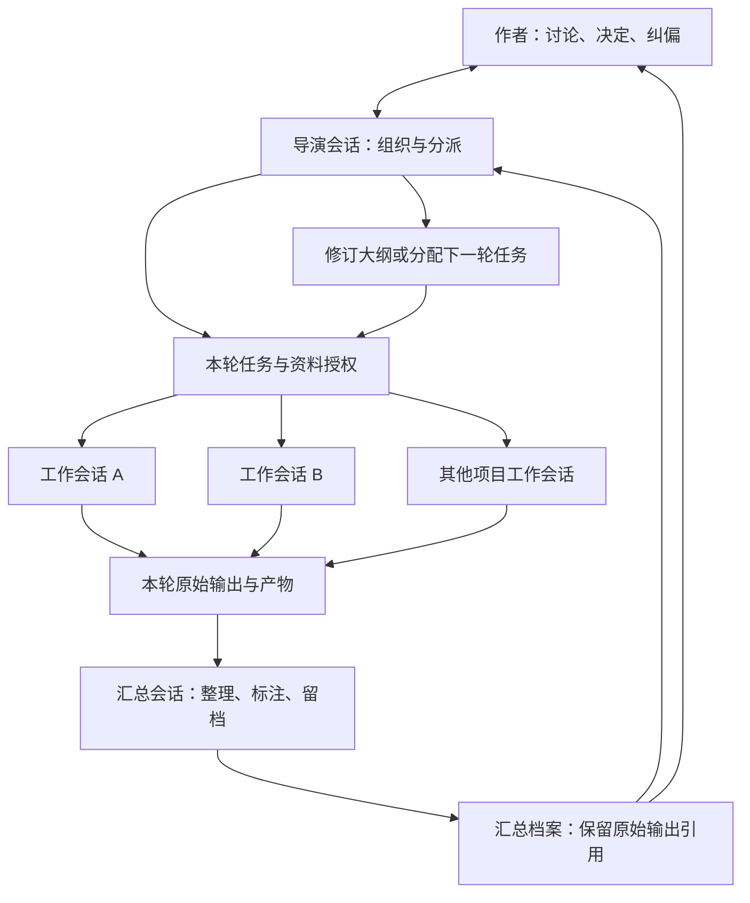

# 写作 Super-agent 架构讨论稿

日期：2026-11-05

版本：v0.3

状态：用于修改和讨论，尚未批准为实现规格；不表示下述能力已经完成。

> 核心：作者与导演组织工作，多个持续会话承担项目分工，按权限访问文档和记忆；每轮由汇总会话整理下层输出、归档供上层阅读。
>
> 写作特化建立在通用 Agent 能力之上；MCP 是通用扩展方式。
>
> **汇总会话只汇总、留档，不处理正式稿件，不替作者或导演决定剧情与设定。写手是另行指定的工作职责。**

## 1. 如何修改这份文档

- “已确认”记录用户明确表达的要求；后续讨论可以继续修改这些决定。
- “设计建议”是为使架构可运行而提出的补充，不应当作用户已经同意的细节。
- “待讨论”保留尚未选定的实现路线与默认行为，集中在第 11 节。
- 当前先确定逻辑架构。技术选型、开发顺序和完整接口另行整理。
- 本文与早期建议不一致时，以本轮确认的职责边界为准，尤其是汇总会话的职责。

## 2. 已确认的核心决定

| 编号 | 决定 |
| --- | --- |
| C01 | 主场地是本地 DSH；写作协作不以 GitHub Issue、PR 或其他远程开发平台为必需入口。 |
| C02 | 最高层是作者（用户）与导演会话。两者对项目故事资料全知，可以随时讨论故事、生成或调整大纲、确定剧情走向。 |
| C03 | 作者可以吩咐导演给下层会话分配任务。不同会话得到不同任务、资料与权限。 |
| C04 | 一轮协作后，汇总会话收集下层输出，整理并留档，供作者、导演等上层阅读。正式稿件不归汇总会话处理。 |
| C05 | 底层记忆需要隔离：不同文档可以有不同权限，不同会话据其权限获得信息。 |
| C06 | 工作会话的具体职责由项目安排，不固定为某几个角色。人物、线索策划、写手、审校等均为可配置职责。 |
| C07 | 推演生成大纲、按大纲写作两种功能都需要；写作中的新发现可以继续促使大纲调整。 |
| C08 | 人物独立会话带来的差异与化学反应值得保留；作者与导演可以干预、纠偏和取舍，不要求系统自主决定整部作品。 |
| C09 | 写作 Agent 保留传统通用 Agent 的能力，并可通过 MCP 等机制扩展；写作特化不应把 Agent 缩减成固定流程或少量专用工具。 |

“全知”表示作者、导演有权读取项目内的完整故事资料、显式笔记和输出；实际上下文仍需按任务选取，不要求每轮塞入全部历史。它不表示需要向模型开放账号凭据等与故事无关的信息。

## 3. 会话结构与职责



图中表示主要协作关系，不要求所有工作会话在同一时间启动，也不限定它们必须同步结束。

### 3.1 作者（用户）

- 与导演讨论创作意图、设定、大纲和剧情。
- 查看全部项目资料、下层输出与汇总档案。
- 调整任务、角色职责、资料权限与创作方向。
- 对不合意的发展进行纠正、取舍或要求重新推演。

### 3.2 导演会话

- 维护与作者当前达成的创作安排，组织大纲讨论和修订。
- 根据项目和当前需要，给工作会话分配任务、参考资料和预期产物。
- 阅读原始输出及汇总档案，处理冲突、待决定事项和下一轮安排。
- 依据项目授权规则组织信息投递，避免将上层知道的内容自动暴露给下层。

**设计建议：**导演可以提出和管理任务，但会话权限的实际执行由程序负责。导演文本中的一句“授予权限”不能绕过项目授权规则。

### 3.3 工作会话

每个会话有自己的持续历史、职责说明、模型配置和可访问资料。职责可以跨轮保持，也可以由项目重新安排。

以下是例子，不是固定角色名单：

| 项目需要 | 可安排的职责 |
| --- | --- |
| 故事讨论 | 主线策划、支线策划、设定讨论、资料研究 |
| 人物演绎 | 人物 A、人物 B，或某一阵营、某条线索 |
| 正文写作 | 章节写手、场景写手、修改润色 |
| 检查与辅助 | 一致性检查、时间线检查、状态处理、信息可见性判断 |

负责正式稿件的写手也是工作会话，按项目获得相应写入权限。不能因为存在汇总会话，就默认由它写正文。

### 3.4 汇总会话

**已确认职责：**

1. 读取本轮指定工作会话提交的输出与产物。
2. 按任务整理各会话做了什么、产生了什么结果。
3. 保留原始输出的引用，标注相互冲突、尚未完成、需要上层决定的内容。
4. 形成汇总档案并留存，供上层阅读。

**明确边界：**

- 不负责生成、修改或发布正式稿件。
- 不直接修订大纲或正式设定，不替上层选择剧情分支。
- 不把建议、推测或失败尝试改写成已经确认的事实。
- 不因整合了多个会话的信息，就向下层公开整份汇总。
- 对无法判断的矛盾并列记录，交给导演或作者处理。

**设计建议：**汇总会话的写权限只覆盖汇总归档区域；本轮工作产物及其授权引用为只读。汇总会话是否常驻、是否按任务组设置多个，见第 11 节。

这里的“输出”和“笔记”均指模型明确返回或显式保存的内容，不要求获取模型不可见的内部推理过程。

### 3.5 通用 Agent 能力与工具扩展

**已确认：**导演、汇总及其他工作会话都建立在通用 Agent 能力基座上。文件读写与搜索、工具调用、Shell／代码执行、联网检索、技能和 MCP 扩展等传统 Agent 能力，应在写作 Agent 中保留，而不只提供一组写作专用按钮。

具体工具接入优先沿用 DSH 的现有机制，MCP 服务按项目需要添加。

会话职责和资料读写范围仍按项目执行。例如，汇总会话保留通用 Agent 的工具接入能力，但不能据此修改正式稿件；其职责边界不变。

**待讨论想法：**是否需要进一步为每个会话设置可用工具、禁止工具等规则，用户尚未确定，也认为可能没有必要。当前不把会话级工具允许／禁用列表作为必需功能，不预设某一类会话必须关闭某种工具。

## 4. 一轮协作与持续创作

### 4.1 “一轮”的含义

**设计建议：**一轮是导演组织的一组相关任务，有明确参与者、输入依据和汇总范围。

- 一轮协作不等于一次模型调用，也不等于完整的 DSH 会话。
- 工作会话可以跨越多轮持续存在。
- 一轮可以用于讨论、推演、资料研究、正文写作或审校，不只用于人物扮演。
- 不必每轮唤醒所有会话。

### 4.2 基本流程

1. 作者与导演讨论本轮目标，引用当前的大纲、设定或待解决问题。
2. 导演分配任务，指定各会话可读取的资料、可写入的范围和预期输出。
3. 工作会话在各自权限内工作，提交输出、文档产物、进度或协调请求。
4. 达到本轮结束条件后，收集已提交的原始输出；缺失、失败和未完成项保留其真实状态。
5. 汇总会话整理本轮结果，写入汇总档案。
6. 作者与导演阅读汇总；需要时回到原始产物核查。
7. 上层决定采用、调整、继续讨论或安排下一轮；正式资料由其指定的有权限会话修改。

**设计建议：**汇总失败不丢失下层原始输出，可以重试汇总。迟到结果追加为补充档案或新版本，不能悄悄替换上层已阅读的版本。自动结束、人工结束和未完成任务的具体处理仍待讨论。

### 4.3 大纲与推演的关系

两种功能属于同一个循环：

```text
讨论与推演 → 暂定大纲 → 分工写作／继续推演 → 汇总新发现
    ↑                                             ↓
    └──────────── 讨论、取舍、修订大纲 ────────────┘
```

导演可以按当前需要强调探索或强调既定目标。不能把“选定一种默认模式”理解为关闭另一种能力。

### 4.4 项目例子：从人物推演到成稿

- 第一轮：导演给三个人物会话不同资料，让它们处理一次冲突。
- 汇总会话保存三方输出，标出行动分歧、共同观察与尚未解决的问题；不写小说正文。
- 作者与导演阅读后，决定采用哪些发展，以及是否调整大纲。
- 下一轮：导演将选定资料交给指定写手，写手生成或修改授权稿件。
- 汇总会话再归档这一轮的写作成果、修改说明和待决定项，正式稿件仍由写手及项目指定负责人处理。

这只是一个项目配置示例；纯剧情规划项目不必设置人物会话，其他项目也可以有不同分工。

## 5. 文档、记忆与权限

### 5.1 文档是记忆载体

“文档”是逻辑上的资料单元，可以落实为本地 Markdown、结构化文件或数据库记录，格式尚未选定。

可以保存：大纲、设定、稿件、任务资料、会话显式笔记、原始输出、汇总档案。不同资料不必一开始就采用复杂的世界模拟模型。

**设计建议：**每个资料单元至少能识别所属项目、稳定标识、版本、负责人、允许的读取者和写入者。草案、建议、已确认资料应能区分，具体表示方式待实现设计决定。

### 5.2 权限与职责分别配置

角色名称本身不自动赋予全知或写入权。项目为每个会话配置职责和权限，任务可以进一步缩小本次可访问范围。

| 主体 | 默认读取范围（建议） | 默认写入范围（建议） |
| --- | --- | --- |
| 作者 | 项目全部故事资料、输出和记录 | 项目资料及配置 |
| 导演 | 项目全部故事资料、输出和记录 | 其被授权维护的大纲、安排和资料；可以组织进一步授权 |
| 工作会话 | 项目和当前任务授权的资料、自己的持续历史 | 其负责且获授权的文档、草稿与笔记 |
| 汇总会话 | 本轮提交输出，以及为汇总明确授权的引用资料 | 汇总档案区域 |

除已确认的作者／导演全知和汇总职责边界外，具体默认权限仍是建议，不是固定产品规则。

### 5.3 文档权限与工具权限分别讨论

**已确认：**文档和记忆的可见、可修改范围需要隔离。**尚未确定：**是否额外为每个会话限制可调用的工具。两者不能混写成同一个已确认要求。

**设计建议：**资料权限应覆盖实际的读取、写入、搜索、列举、检索、引用和消息投递过程。

- 搜索结果的标题、片段及引用，也不能泄露无权读取的资料。
- 会话不能自行扩大权限；任务正文、文档内容和其他会话的消息也不能自行授予权限。
- 所有权限均以项目为边界；跨项目共享需要明确授权，不能默认继承。

**需要继续讨论的实现问题：**如果文件、Shell 或某个 MCP 可以直接访问底层资料，怎样在保留通用 Agent 能力的同时落实文档权限？受控资料访问、限定工作区、沿用宿主权限机制等都是候选方式，尚未选择。不能仅凭提示词或文件夹分类就宣称已经完成隔离，也不能据此提前认定必须禁用某类工具。

### 5.4 信息转发与衍生资料

把秘密复制进摘要、任务说明或新文档，仍然可能泄露信息。新资料需要继承适当的可见范围，不能通过换文件名自动变成公共资料。

汇总档案默认供作者与导演等获授权的上层读取。下层需要哪些内容，由导演或项目明确授权的投递规则决定；可以产生面向不同收件人的版本。

**待讨论：**哪些共享观察可以自动投递，哪些需要导演裁定；是否允许工作会话主动互相发消息，以及怎样授权。当前不默认存在所有会话都能看到的群聊。

### 5.5 版本变化与已经知道的信息

- 大纲或共同资料更新后，相关任务应能识别自己仍在引用哪个版本。
- 旧版本上的结果标记为需要复核，保留仍有效的部分，不一律删除重做。
- 撤销文档权限不能让会话自动忘记已经进入历史的内容。需要收窄既有会话知识时，应从适当上下文重新建立或分出会话。
- 如果未来支持回退或分支推演，故事资料与各会话历史必须关联同一分支，避免废弃推演进入正式创作。

## 6. 底座需要管理的对象

以下为逻辑模型，不是已确定的数据库表或接口格式。

| 对象 | 最少需要表达的内容 |
| --- | --- |
| 项目 | 创作目标、会话分工、资料范围、权限配置、当前安排 |
| 会话 | 身份、职责、持续历史、模型配置、工具接入、资料读写权限 |
| 任务 | 由谁分配、给谁执行、目标、输入资料及版本、预期产物、状态、所属轮次 |
| 文档 | 内容、项目归属、版本、可见范围、可修改范围、负责人及来源 |
| 结果 | 对应任务与会话、原始输出、产物引用、进度／完成情况、待决定问题 |

“轮次”可以作为任务的组织关系，“汇总档案”可以作为文档与结果的一种用途，是否需要独立实体留给具体设计。

**设计建议：**对任务分派、结果提交、汇总版本和关键资料修改保留可追溯记录；重启后能够恢复当前会话、任务关系和已归档结果。没有提交成功的结果不能被当成已经归档。

## 7. 界面需要让用户看见什么

本节只描述应可查看的信息，不确定具体屏幕布局。

1. 与导演的持续讨论，以及当前大纲和创作安排。
2. 项目会话名单、职责、运行状态和当前任务。
3. 每个会话获准读取和修改的资料范围。
4. 本轮下层输出、汇总档案及其原始引用。
5. 大纲或共同资料的变化，以及哪些结果尚需复核。
6. 需要上层决定、任务失败或等待输入的明确提示。

作者能够查看任意项目会话；普通会话的工具和上下文仍只获得其授权内容。用户界面的全知视图不能被直接当作所有会话共享的上下文。

## 8. 与 DSH、Super-agent 和既有工具的关系

### 8.1 当前已有内容

- 原版源码：`code/external/dsh-superagent-prototype`，用于原版体验和跟进上游。
- 开发仓库：`code/superagent-writing`，对应公开 fork `li-ziwq/superagent-writing`。
- 原版具有持续会话、任务调度、结果投递、存储和监督面板，但围绕 GitHub 开发工单组织。
- 此前写作实验使用过原型核心和实验适配器，没有完成本文架构的产品实现。

原版已经能够打开面板，不代表本文描述的权限化写作系统已经具备。

### 8.2 实现路线比较——待选定

| 路线 | 可利用的部分 | 需要处理的问题 | 当前状态 |
| --- | --- | --- | --- |
| 逐步改造原版，替换任务入口及开发工作流 | 现有 Engine、存储、工具和面板 | 剥离强制 GitHub 初始化、PR 结束条件、工单与会话的固定关系等假设 | 讨论过，尚未选定 |
| 在 fork 内新增写作模块，复用可分离组件与 DSH 会话能力 | 会话接口、可复用存储／投递／展示组件 | 新建符合本文对象关系的写作调度和权限机制 | 助手此前推荐，用户尚未确定技术路线 |

无论选择哪条路线，均需保留通用 Agent 能力，并落实本文的汇总边界和资料权限。需要审视原型中 `danger-full-access` 及文件、Shell 等工具的访问方式与资料隔离是否兼容；目前不据此确定会话工具黑白名单，也不预先移除这些能力。

### 8.3 通用工具接入与可借鉴方案

- MCP 作为通用工具扩展机制接入，具体服务按项目需要选择。向量搜索只是其中一个例子，本架构不为它单独设置模块、职责或数据模型。
- 各 MCP 按其自身接口提供能力；使用外部服务时，资料访问和信息流仍需与项目权限协调，具体接入方式留待实现设计。
- 模型与工具优先复用 DSH 已支持的能力，具体职责使用什么模型由项目安排，不固定为某个厂商。
- Novelcrafter 的场景资料组织和按场景生效的设定变化，可以作为产品设计参考，不预设其提供可直接调用的 MCP 接口。
- LangGraph 的中断和检查点机制、ink 的状态与分支表达，可以作为后续选型参考。当前不预先决定引入这些框架，也不让多个框架各自维护互不一致的运行状态。

## 9. 核心与增强功能的边界

| 核心底座 | 可按项目增加的增强功能 |
| --- | --- |
| 通用 Agent 能力和 MCP 等扩展机制 | 按会话设置工具允许／禁用规则（待讨论，不预设必需） |
| 作者与导演持续讨论、分派任务 | 多个全知专家分工或更复杂的导演组织 |
| 按项目配置工作会话职责 | 固定人物模板、阵营模拟、主动角色行为 |
| 权限化资料与持续会话历史 | 精细的世界状态、人物认知、读者知情记录 |
| 原始结果收集、汇总与归档 | 特定类型的剧情、节奏、文风与一致性审校 |
| 大纲可调整、任务可识别资料版本变化 | 分支推演、回溯、多个方案对比 |
| 必要的状态查看与失败提示 | 时间、物资、伤势、行动结算等跑团规则 |

增强功能不能改变汇总会话只整理留档的职责。复杂模拟、额外 Agent 和更多模型调用是否值得，应看它们是否减少作者的组织和修改负担。

## 10. 后续实现的验收方向

以下是未来验收用例，不是已经通过的测试：

1. 作者与导演讨论后，能够将不同任务和不同资料分配给不同会话。
2. 工作会话无法通过读取、搜索、工具调用、引用或汇总档案获取未授权资料。
3. 同一会话跨轮保持自身历史，不同会话和不同项目不会自动共享私有上下文。
4. 汇总会话能够整理本轮输出并保留原始引用；尝试修改正式稿件、大纲或设定时被拒绝。
5. 获授权的写手可以处理稿件；汇总会话只记录该任务的产物与结果。
6. 汇总能够并列展示矛盾、缺失和失败，不能把未完成任务表示为完成。
7. 大纲调整后，相关旧结果被标记为需复核；已经有效的产物仍可使用。
8. 可以先推演后定大纲，也可以按大纲写作并回到讨论修订，二者共用同一项目资料体系。
9. 改换项目分工后仍能运行，不依赖固定的三个人物或固定写作流程。
10. 重启后仍可找到当前任务、会话关系、原始结果及汇总档案。
11. 能够使用宿主提供的通用 Agent 能力并接入不同 MCP，不预设某一 MCP 必须安装或独立成架构模块。是否单独验收会话级工具允许／禁用规则，待该功能被选定后再决定。

## 11. 待讨论事项

| 编号 | 问题 | 为什么需要决定 |
| --- | --- | --- |
| Q01 | 一轮何时结束：导演手动结束、任务全部提交后结束，或两者结合？ | 影响汇总触发、长任务和部分失败的处理。 |
| Q02 | 汇总会话按项目持续存在，还是按轮次建立？是否允许分组汇总？ | 影响归档组织、上下文长度和成本；职责边界不变。 |
| Q03 | 工作会话怎样提出协调请求？哪些通信可由项目规则自动投递？ | 影响人物交互效率和秘密传播边界。 |
| Q04 | 大纲和正式设定的确认、修改权如何分配给导演及工作会话？ | 已确认汇总会话不参与正式稿件处理；其他职责的具体写权限仍需项目规则。 |
| Q05 | 权限粒度先做到文档，还是还需要章节、片段或字段级控制？ | 影响资料组织、搜索过滤与实现成本。 |
| Q06 | 使用第 8.2 节哪条实现路线？ | 影响原型核心的复用程度和后续维护方式。 |
| Q07 | 文档与运行记录怎样落盘，怎样在编辑器中修改后同步权限和版本？ | 影响本地文件使用体验、并发修改与恢复。 |
| Q08 | 是否需要为单独会话设置工具允许／禁用规则，还是只沿用通用 Agent 与宿主能力？ | 用户保留这一想法，也认为未必必要；需要结合资料隔离的实现方式讨论，当前不作必需功能。 |

这些问题不影响先讨论和修订本文；编写详细实现计划前再逐项收敛。暂不安排开发排期，也不默认原型的每个模块都需要保留。

## 12. 参考与讨论记录

前三项指向本地写作工作区的记录，不随这个 GitHub 仓库发布；单独阅读仓库时，可先依据本文的已确认要求讨论。

- [此前多会话实验与边界](../../../../workbench/notes/superagent-writing-findings.md)
- [多个全知会话的可行性与未实现项](../../../../workbench/notes/superagent-multiple-hosts.md)
- [原版和开发仓库的分工](../../../../workbench/notes/superagent-repositories.md)
- [原型架构说明](../007-architecture.md)
- [原型任务来源扩展说明](../008-cookbook.md)
- [Novelcrafter：设定随场景生效](https://www.novelcrafter.com/help/docs/codex/progressions-additions)
- [LangGraph：持久化](https://docs.langchain.com/oss/javascript/langgraph/persistence)
- [ink：分支叙事引擎](https://www.inklestudios.com/ink/)

### 修订记录

| 版本 | 日期 | 内容 |
| --- | --- | --- |
| v0.1 | 2026-11-05 | 根据用户总结建立可编辑的架构讨论稿；明确汇总会话只收集、整理、归档下层输出，正式稿件由项目指定的写作职责处理。 |
| v0.2 | 2026-11-05 | 根据用户修订，明确写作 Agent 保留通用 Agent 能力，向量搜索只是 MCP 扩展之一，不再单列为核心要求；会话级工具允许／禁用规则保留为待讨论想法，与已确认的文档权限隔离分开。 |
| v0.3 | 2026-11-05 | 文档迁入项目专用目录 `docs/superagent-writing/`，更新引用；根 README 改为本项目入口，继承原型文档与目标设计分开说明。架构决定不变。 |
